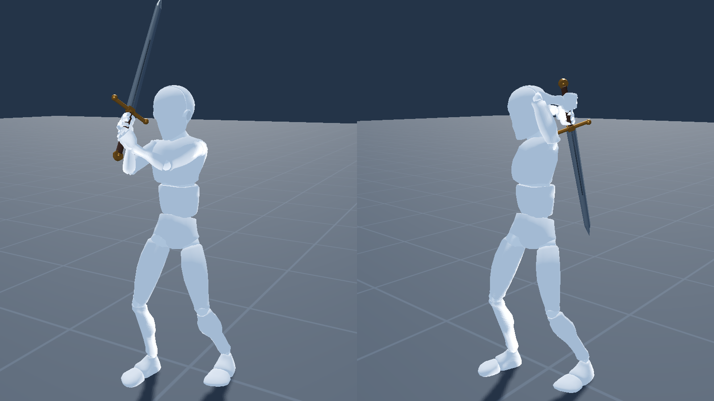

# Navi Sword — рука мечника на гироскопе

Откройте `project.godot` в Godot **4.7.2 .NET** и нажмите **F5** (нужен .NET SDK 8
или новее). Единственная сцена — `scenes/joint_lab.tscn`: манекен Mannequiny с
одноручным мечом в правой руке. Рукой управляют геймпад с гироскопом
(DualSense) или ползунки справа.

## Управление

При подключении геймпад 2 секунды калибруется — пусть лежит на столе. Потом
возьмите его, как держите меч в средней стойке, и нажмите **R1**. Дальше R1 — «сцепление»:
пока кнопка зажата, рука удерживает позу и гироскоп не влияет на меч — можно удобно
перехватить геймпад. После долгого удержания управление продолжается от нового положения
геймпада. Короткое нажатие (меньше 0,3 с) после отпускания плавно возвращает меч в среднюю
стойку за 0,2 с. Повторное удержание R1 останавливает этот возврат.

| Ввод | Обычный режим | Держать L1 — точная работа |
|---|---|---|
| Гироскоп: нос вверх / вниз | Поднять / опустить руку | Согнуть / разогнуть локоть (плечо — на четверть) |
| Гироскоп: поворот влево / вправо | Завести руку поперёк груди / отвести в сторону и за спину | Увести предплечье, поворачивая руку в плече (плечо — на четверть) |
| Гироскоп: крен | Повернуть плечо наружу / внутрь | Повернуть предплечье ладонью вверх / вниз |
| Правый стик ↑↓ | Локоть (вниз — согнуть) | Сгиб кисти |
| Правый стик ←→ | Поворот предплечья | Отклонение кисти |
| Левый стик (или W A S D) | Ходьба: вверх — от камеры, вбок — вбок (камера — какой была в начале шага: поворот камеры на ходу не меняет направление) | То же |
| Зажать L3 (или Shift) | Бег: до 2,4 м/с вместо 1,1, шаги чаще и выше, корпус ниже | То же |
| ✕ (или пробел) | Прыжок: присед, взлёт ~0,35 м с сохранением скорости шага или бега, мягкое приземление | То же |
| R2 | Плавно разогнуть локоть (конец рубящего удара) | Укол с выпадом по линии клинка (L1 сам ставит остриё вперёд) |
| R1 | Первое нажатие — средняя стойка; дальше короткое нажатие — плавно в стойку после отпускания, долгое удержание — замереть для перехвата геймпада | То же |
| R1 + правый стик ←→ | Повернуть камеру вокруг бойца, в том числе при зажатом L2 — уклон сохраняется (рука стоит; так отпущенный R1 не возвращает в стойку, а стик снова ведёт руку, только вернувшись в центр) | То же |
| R3 (нажать правый стик) | Камера обратно за спину | То же |
| △ | Калибровка гироскопа (геймпад на столе) | То же |
| Держать L2 | Гироскоп управляет корпусом: нос вниз — наклон вперёд и небольшой присед, крен — боковой уклон со смещением таза, поворот — разворот груди | Приоритет над L1; поза руки удерживается |

Галочка **«Меч в левой руке»** на панели делает бойца левшой. Логика остаётся правшой (невидимым),
а на экране — вторая, обычная модель, которой каждый кадр передаётся **зеркальная поза**: кость
левой стороны получает отражённое движение парной правой (`.l` ↔ `.r`), кость середины — своё,
отражённое; движение берётся от исходной позы скелета. Модель не выворачивается, поэтому надписи
на одежде читаются, асимметричные детали остаются на своих местах, карты нормалей и физика костей
работают как обычно — подойдёт любая будущая модель с парными костями (риги Blender, Mixamo).
Меч рисуется отражённым вместе с кистью, камера встаёт над левым плечом; пол, свет и тени не
отражаются. Управление «влево/вправо» зеркально: поворот и крен геймпада, оба стика, A/D.

Галочка **«Меч двумя руками»** (отдельная настройка, по умолчанию — одной): рукоять удлиняется
до полуторной, вторая рука берёт её под первой тем же хватом (пальцы сжимаются зеркально). Ведёт
по-прежнему рука с мечом — геймпад, лезвие, доводка кистью как были; вторая подстраивается: каждый
кадр, когда рука с мечом уже встала на место, обе руки «встречаются» — рука с мечом уступает
несколько градусов (больше всего кисть и предплечье), вторая берёт рукоять, не входя в тело.
Поэтому там, куда вторая не дотягивается (далеко вправо, за спину), рука с мечом ею удержана.
Стойка двумя руками: локти согнуты сильнее (105°) и разведены в стороны (плечо приподнято до 55° и повёрнуто внутрь), кисти перед грудью — так мечом двигать проще; вторая рука тоже держит локоть в стороне. Корпус при двух руках стоит прямее и сильнее поворачивается вслед за руками. Занести меч за
голову двумя руками можно: руки сходятся над головой, клинок висит за спиной.
Галочка **«Отпускать вторую руку, где она не достаёт»** вместо этого отпускает вторую руку там,
куда она не дотягивается (рука с мечом свободна), и плавно возвращает её на рукоять, когда может.
Работает и левшой.

При управлении корпусом через L2 справа появляется блок **«УКЛОНЕНИЕ — L2 + гироскоп»**;
вне этого режима он скрыт. В нём пять ползунков для наклона
вперёд/назад, бокового наклона, дополнительного поворота груди, смещения таза в сантиметрах
и приседа. Значения показывают цель и текущее положение;
кнопка «Выпрямить корпус» плавно возвращает их к нулю.
Два отдела позвоночника делят наклон, шея и голова частично компенсируют его. Ноги сгибаются
через обратную кинематику, стопы сохраняют опору, при большом боковом смещении следуют подшаги.
L2 берёт положение геймпада в момент нажатия за центр; после отпускания тело плавно
выпрямляется, а управление мечом подхватывается от нового положения геймпада. R1 имеет приоритет.
Направления уклонения считаются по последовательным поворотам вокруг локальных осей
геймпада, без вычитания абсолютных углов: проход через ±180° или вертикальный хват
не переворачивает знак управления. R1 переносит удобный центр, а не исправляет направление.
Не отпуская L2, зажмите R1 и удобно перехватите геймпад: корпус быстро выпрямится,
а после отпускания R1 новое положение геймпада станет центром уклонений. Короткое нажатие
тоже задаёт нейтральный центр, даже если корпус ещё не успел завершить возврат.
Если же при зажатом R1 повернуть правый стик — это поворот камеры: корпус остаётся в уклоне,
а после отпускания R1 уклон продолжается от нового положения геймпада без скачка
(первые 0,3 с удержания R1 корпус ждёт, не камера ли это).
Диапазоны ползунков — ограниченный игровой диапазон уклонения, не медицинская модель позвоночника.

При отпускании L1 вся рука (плечо, локоть, предплечье и обе оси кисти) плавно возвращается
в базовую стойку за 0,8 с. Повторное нажатие прерывает возврат и начинает точный режим
с текущей позы. После возврата положение геймпада становится новым центром управления.

Наклон геймпада двигает руку на 1,5° на градус, поворот — на 2,5° (вправо усиление
плавно растёт: до упора назад — поворот на 35°, до упора поперёк груди — на 20°; поворот кисти
меньше, поэтому сильнее). При смене режима всё продолжается с того места, где
рука, — ничего не прыгает. Сигнал геймпада сглажен фильтром «1€» (Casiez и др.,
2012): дрожь руки и шум датчика гасятся, быстрые движения проходят почти без
задержки. Слева — состояние геймпада и живые значения гироскопа, справа —
ползунки каждого сустава («задано → на самом деле», если рука во что-то упёрлась).
Кнопки «Случайно», «Правая», «Левая» ставят случайную допустимую позу.

## Анатомия — не придуманная

- **Суставы и их пределы** — из модели руки MoBL-ARMS (Holzbaur 2005, Saul 2015,
  Стэнфорд/OpenSim) в версии MyoSuite (`MyoHub/myo_sim`): плечо как плоскость
  подъёма, подъём и вращение; ключица поднимается и уходит назад вместе с рукой.
- **Вращение плеча** отсчитывается от удобного положения предплечья для данного
  направления руки (вперёд, когда рука внизу или в стороне; вверх, когда вперёд;
  назад, когда над головой). Ход вращения зависит от положения: ~157° у опущенной
  руки, ~94° над головой (Wang и др., 1998); в сторону 90° наружу и 70° внутрь
  (AAOS); вперёд наружу почти не поворачивается (Inui и др., 2009).
- **Подъём**: до 155° в сторону и 165° вперёд (Gill и др., 2020); за спину
  назад-вбок до уровня плеча, прямо назад до 55° (AAOS); поперёк груди ниже.
- **Кисть**: сгиб и отведение вместе ограничены эллипсом.
- **Болевые зоны**: поднятая рука с вращением внутрь (тесты Neer и
  Hawkins-Kennedy), поднятая рука далеко поперёк груди. Цель выводится из них заранее.
- **Нагрузка позы** по схеме LUBA (Kee и Karwowski, 2001; Kee, 2007): баллы за
  каждый сустав по углу. Поза тяжелее 12 баллов (конец категории II) — такая же
  болевая зона. Геймпад вибрирует по этой нагрузке, если поза удерживается
  (вибрация нарастает за ~0,6 с, замах сквозь тяжёлую позу не жужжит): до 7 баллов —
  нет, дальше во II слабо, в III сильнее (подключается тяжёлый мотор), в IV — до
  полной силы к 35 баллам; плавно по числу, не ступенями. Общая сила — ползунок
  «Сила вибрации» (по умолчанию 30%), слабые значения смягчены сильнее.
- **Выносливость**: в позах тяжелее 7 баллов рука устаёт (высокая позиция ~10
  баллов — примерно за 25 с, поза в 25 баллов — за 4 с), в лёгких — отдыхает
  (опущенная рука — за ~5 с). Уставшей руке предел нагрузки снижается с 12 до 7:
  тяжёлые замахи и позиции сами становятся ниже и короче (уступают локоть и подъём);
  рука движется медленнее (до половины скорости), а вибрация ту же позу ощущает
  сильнее. Полоска и галочка — в панели геймпада. Выключается галочкой в панели геймпада. Стойки с мечом укладываются: средняя ~3,5 (плечо на 38°, категория I), укол ~3, высокая ~10.

## Меч, хват, корпус, левая рука

- **Хват «рукопожатием»** одноручного меча: рукоять наискось через ладонь, глубоко
  у ладонной складки, мизинец у навершия; три пальца сжимаются по фалангам, пока
  не лягут на рукоять, большой палец обходит её навстречу; острое ребро в сторону
  костяшек. Кисть по умолчанию немного разогнута и отведена к мизинцу (рабочее
  положение сильного хвата). Сжатый кулак одинаков в любой позе — считается один раз.
- **Корпус** стоит боком, правым плечом вперёд на 30°, и доворачивается за рукой:
  замах назад — вправо, замах слева — влево (до −45…+60°). Голова смотрит вперёд.
  Корпус плавно догоняет цель (1/15 с, до 240°/с), не повторяя мелкой дрожи.
  Стопы переставляются, когда корпус сильно поворачивается; камера поворачивается
  вместе со стойкой (не с корпусом), так что персонаж остаётся к ней тем же боком.
  Левым стиком боец ходит (`scripts/JointLabWalk.cs`) — по-фехтовальному, в стойке, не
  разворачиваясь в сторону движения, до 1,1 м/с с плавным разгоном: ноги шагают по
  очереди (вперёд первой — передняя, назад — задняя, вбок — та, что с той стороны),
  каждая ставится с упреждением, чтобы не отставать; корпус приседает в колени,
  поднимается над опорной ногой и переносит на неё вес. Камера едет за бойцом без тряски.
  Угол камеры по умолчанию — свойство сцены `CameraOrbit` (180°, сзади); сзади она
  стоит над правым плечом и смотрит вперёд мимо персонажа (`CameraHeight`, `CameraSide`,
  `CameraLookAhead`), чтобы тело не закрывало меч. Где тело всё же заслоняет меч, оно
  растворяется решёткой (дизеринг, как в Deadlock): только в полосе вокруг меча на
  экране и только то, что заметно ближе к камере, чем меч; остальное тело сплошное.
  Галочка «Манекен растворяется вокруг меча», свойства `SeeThroughKeep`, `SeeThroughWidth`.
- **Левая рука** прижата к спине и согнута в локте, предплечье поперёк поясницы.
  Она ни на что не реагирует: её двигают только её ползунки; из тела её поза
  выводится один раз, когда меняются ползунки или корпус заметно поворачивается.

## Укол

Точный режим (L1) — для укола (`scripts/JointLabThrust.cs`). При нажатии L1 рука за 0,35 с
приходит в стойку: кисть перед животом, рука вперёд, клинок смотрит на противника (на уровень
лица, чуть вверх). Наводят плечо и локоть; предплечье и сгиб кисти не трогаются, помогает
только отведение кисти к мизинцу — её естественный наклон при хвате «рукопожатием». Корпус
весь точный режим держит поворот, с которым нажат L1. R2 — укол с выпадом: кисть идёт
вперёд, остриё опускается к корпусу противника (до 20°), корпус подаётся следом (до 35 см)
и опускается в выпад, передняя нога выносится вперёд (~75 см), задняя почти стоит. Отпустили
R2 — возврат в стойку. Углы подбирает маленький решатель (Гаусс — Ньютон) с весами суставов.

## Звук

Звук меча синтезируется из самого движения (`scripts/JointLabSound.cs`): свист — шум
через полосовой фильтр, громкость и высота по скорости острия: обычные движения беззвучны,
свист начинается с 6 м/с и полон к 16 м/с; уставшая рука звучит ниже. Ползунок «Громкость
меча» (по умолчанию 35%). R2 — свой хлёст: щелчок при нажатии (тем
резче, чем быстрее нажат курок) и финальный хлопок, когда локоть почти разогнулся.
По USB у DualSense есть свой динамик — галочка «Звук в динамик геймпада» отправляет
звук туда и включает сам динамик (на ПК он молчит, пока его не включить командой по
HID, как курки). `tests/probe_audio.gd` (с окном) играет тон 440 Гц через динамик геймпада.

Адаптивный курок R2 (`scripts/DualSenseTriggers.cs`, `scripts/JointLabTrigger.cs`):
Godot его не поддерживает, поэтому отчёт DualSense пишется прямо по HID (HidSharp;
USB и Bluetooth, только флаги курков — вибрацию и свет Godot не трогаем). R2 — как
спуск оружия: свободно до середины хода, дальше сопротивление и щелчок у самого
низа, примерно там, где разгибается локоть и звучит хлопок; уставшей руке курок
тяжелее (3/8 → 8/8). При выходе курки освобождаются. Если Steam Input держит
геймпад, курок недоступен — строка в панели это скажет.
`tests/probe_trigger.gd` ставит самый тугой щелчок на 5 секунд — проверить на руке.

## Столкновения и плавность

Рука и меч (клинок, крестовина, навершие) не проходят сквозь голову, туловище и
ноги. Объёмы тела — эллипсоиды, охватывающие 95% вершин каждой части модели,
рука — капсулы её толщины (`scripts/BodyVolumes.cs`; галочка «Объёмы тела» их
показывает). Каждый кадр решатель берёт первое, что подходит:

1. **Прямой шаг** к цели (не быстрее 450°/с при вводе с геймпада), если он ничего
   не задевает. Так проходит почти каждый кадр свободного движения.
2. **Удержание**: суставы, которыми игрок сейчас не управляет (прежде всего кисть,
   отводящая меч от тела), стоят, где их отодвинуло, пока рядом препятствие, и
   сразу возвращаются, когда рука отошла.
3. **Остановка у касания**: рука проходит к цели до касания.
4. **Скольжение** — от точки касания, в том же кадре. Каждая точка руки, клинка,
   крестовины и навершия — отдельное ограничение: рука идёт вдоль всех поверхностей
   сразу, поэтому не встаёт в «углу», где клинок у головы, а крестовина у груди.
   Уступают первыми суставы, которыми игрок сейчас не управляет (кисть, предплечье).
   Где поверхность кривая, точки, зашедшие внутрь, выталкиваются обратно теми же
   ограничениями (`scripts/JointLabSlide.cs`).
5. **Полный расчёт** — только если рука внутри тела и скольжение её не вытолкнуло.

Болевые зоны и нагрузка позы (LUBA) — не препятствия: это функции одних углов,
и на их границе рука стояла, не видя, куда идти (на краю болевой дуги подъём на
боль не влияет, у нагрузки ступени). Цель заранее выводится из них, и у каждой
зоны свои уступающие суставы — прежде всего не тот, которым игрок в неё ведёт:
повёрнутую внутрь поднятую руку выводит из дуги подъём (не дальше 8°, глубже
уступает вращение), нагрузку — подъём и локоть, меньше вращение и кисть,
плоскость — никогда.
То, на что анатомия и удобство меняют заданное игроком, меняется не быстрее
90°/с, а сустав набирает скорость за 0,1 с: на крутых пределах (за спиной
над головой, порог нагрузки) рука доворачивается плавно, а не рывком.

В уже существующее касание шаг не может войти глубже; поэтому у тела нет пилы.
Большие скачки цели (кнопки «Случайно», «Сброс») проходят через поиск
безопасного пути (`scripts/JointLabPlanning.cs`).

`data/joint_contact_map.bin` — заранее посчитанная карта упоров (плечо × подъём ×
вращение × локоть). Сейчас она выключена (`UseContactMap`): посчитанная для кисти
в положении по умолчанию, она спорила с кистью, отводящей меч.

## Код

- `scripts/JointLab.cs` — сцена: модель, суставы, анатомия, решатель, панель.
- `scripts/JointLabPad.cs` — геймпад, гироскоп и вибрация.
- `scripts/JointLabStamina.cs` — выносливость.
- `scripts/JointLabPlanning.cs` — поиск пути для больших скачков.
- `scripts/JointLabSlide.cs` — скольжение по точкам касания.
- `scripts/JointLabFootwork.cs` — шаги ног (`scripts/LimbSolver.cs` — ноги).
- `scripts/JointLabWalk.cs` — ходьба на левом стике, пол.
- `scripts/JointLabMap.cs` — карта упоров, скольжение, корпус, левая рука.
- `scripts/JointLabAssets.cs` — загрузка меча и модели.
- `scripts/BodyVolumes.cs` — объёмы тела по вершинам модели.
- `scripts/SwordMotionModel.cs`, `scripts/OneEuroFilter.cs` — ориентация геймпада.
- `scenes/sword.tscn` — меч; `assets/mannequiny` — манекен (GDQuest, CC BY 4.0;
  его нормали разворачиваются при загрузке, иначе он чёрный).

## Тесты

Каждый тест — `godot --headless --path . --script res://tests/<имя>.gd`:

- `joint_gyro_survey_test` — 16 случайных движений геймпада: полный расчёт
  редок, лишних разворотов суставов мало, кадры короткие;
- `joint_gyro_shoulder_test`, `joint_gyro_behind_test` — подъём плеча и заход за
  спину: рука не отстаёт, не замирает, не дрожит;
- `joint_contact_jitter_test` — рука у тела не пилит;
- `joint_unstick_test` — рука сразу отрывается от тела;
- `joint_gyro_overhead_test` — согнутая рука заводится за голову: решатель редок,
  долгих остановок нет;
- `joint_gyro_overhead_snap_test` — над головой (поперёк, за спину) пределы не
  проворачивают руку рывками;
- `joint_gyro_twist_in_test`, `joint_gyro_painful_arc_test` — плечо, повёрнутое
  внутрь у болевой дуги и в ней: без остановок и качки;
- `joint_camera_follow_test` — после шагов камера смотрит на стойку с той же стороны;
- `joint_pad_swing_test` — крайние замахи вправо и влево при удобном повороте геймпада;
- `joint_follow_through_test` — в конце удара кисть (отведение) доводит клинок дальше по его пути, лезвием вперёд, и потом возвращается;
- `joint_edge_cut_test` — удар справа: предплечье само доворачивает меч на лезвие, рука уходит поперёк груди за 150°;
- `joint_rumble_test` — вибрация растёт с нагрузкой (с 7 баллов) и только в удержанной позе;
- `joint_sword_sound_test` — свист по скорости острия, хлёст и хлопок на каждый удар R2;
- `joint_thrust_test` — стойка L1 остриём вперёд; укол с выпадом по линии клинка и возврат; R2 без L1 разгибает локоть;
- `joint_fine_shoulder_test` — в точном режиме плечо подхватывает четверть движения гироскопа, без скачков;
- `joint_clutch_test` — R1 зажат: рука не меняется; отпущен: без скачка, геймпад снова ведёт;
- `joint_camera_stick_test` — R1 + правый стик поворачивает камеру, рука стоит; R3 — камера за спину;
- `joint_left_hand_test` — «Меч в левой руке»: геймпад зеркален, поза отражена на обычной модели (кости — точно на зеркальных местах), меч в левой кисти, руки названы как видны;
- `joint_two_hands_test` — двумя руками: вторая на рукояти в стойке, в размахах (обычно <1 см) и за головой; режим «отпускать» отпускает и берёт снова;
- `joint_jump_run_test` — бег на L3: шаги по очереди, ноги под телом; прыжок на месте ~0,35 м, из бега — летит дальше, ноги с телом;
- `joint_walk_camera_test` — поворот камеры на ходу не меняет направление ходьбы; следующий шаг — от камеры;
- `joint_dodge_camera_test` — в уклоне (L2) R1 + правый стик поворачивает камеру, уклон не теряется; R1 без стика — по-прежнему перехват;
- `joint_walk_test` — ходьба: шаги по очереди, ни одна нога не отстаёт, остановка и успокоение;
- `joint_stamina_test` — тяжёлая поза утомляет руку, уставшая поза облегчается, опущенная рука отдыхает;
- `joint_live_input_test`, `joint_stability_test`, `joint_planning_test`,
  `joint_search_budget_test`, `joint_footwork_test` — живой ввод, устойчивость,
  поиск пути и шаги ног.

## Лицензия

Код и остальные собственные файлы проекта — под [PolyForm Noncommercial 1.0.0](LICENSE.md):
бесплатно для любого некоммерческого использования (личного, учебного, исследовательского,
для хобби), изменять и распространять можно, сохраняя лицензию и строку `Required Notice`.
Коммерческое использование — только с отдельного разрешения автора.

Сторонние материалы остаются под своими лицензиями: модель `assets/mannequiny/mannequiny.glb` —
GDQuest и соавторы, [CC BY 4.0](https://creativecommons.org/licenses/by/4.0/)
(см. `assets/mannequiny/mannequiny.LICENSE.md`). Диапазоны суставов руки взяты из модели
MoBL-ARMS (Stanford) в редакции myo_sim.
